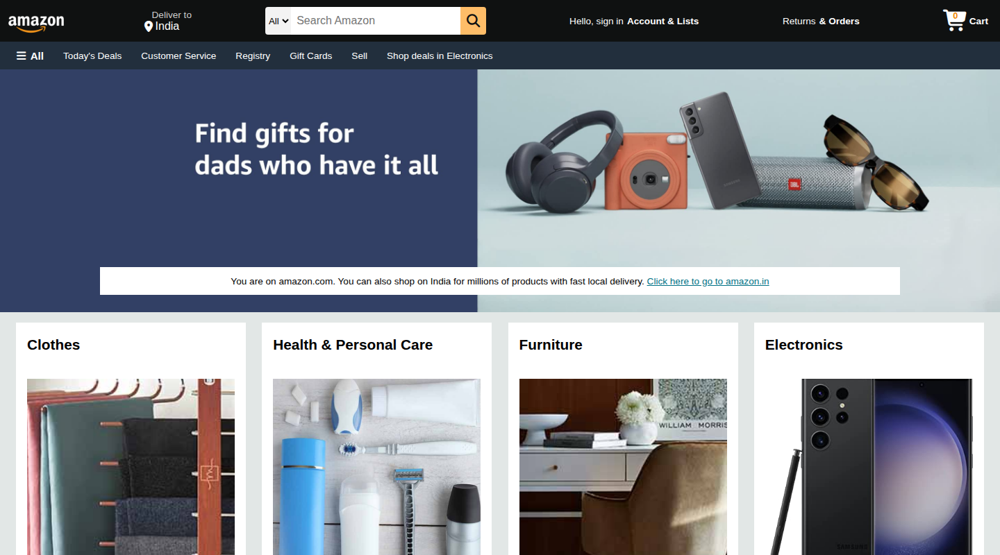
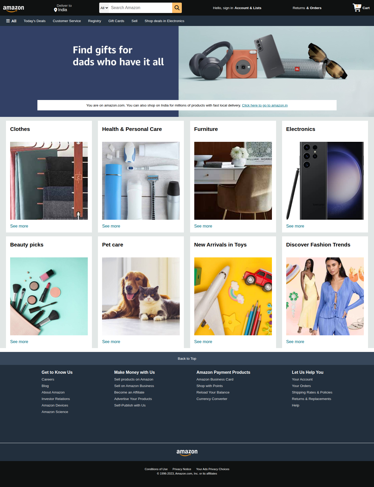
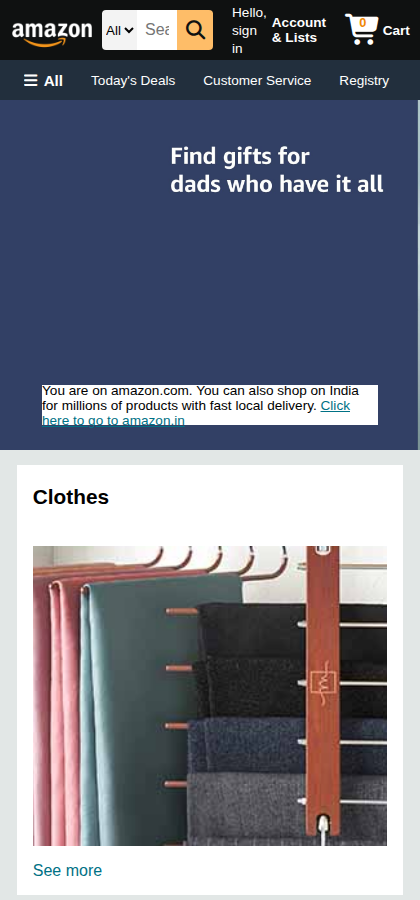

# Amazon Clone

A static front-end clone of the Amazon.com homepage, built with **HTML** and **CSS** as a graduation-time learning project.

> ⚠️ **Disclaimer:** This is an educational project and is not affiliated with, endorsed by, or connected to Amazon. Amazon's name, logo and trademarks belong to Amazon.com, Inc. Product images are used for demonstration only.

## Screenshots

**Desktop – top of page**



**Desktop – full page**



**Mobile**



## Features

- Sticky navigation bar with logo, delivery location, search bar, account, returns and cart
- Single-row secondary menu (All, Today's Deals, Customer Service, Registry, ...) with hover effect
- Working search: opens an Amazon.com search for the typed text
- Cart counter badge (click the cart to add 1 – demo only)
- Hero banner with a regional-site message
- 8 equal-height category cards built with Flexbox
- Four-column footer, smooth "Back to Top" button
- Responsive layout for tablets and phones

## Tech stack

- HTML5
- CSS3 (Flexbox, media queries)
- Vanilla JavaScript
- [Font Awesome 6](https://fontawesome.com/) for icons (loaded via CDN)

## Project structure

```
amazon-clone/
├── index.html
├── style.css
├── script.js
├── screenshots/
│   ├── home-top.png
│   ├── home-full.png
│   └── home-mobile.png
├── images/
│   ├── amazon_logo.png
│   ├── hero_image.jpg
│   └── box1_image.jpg ... box8_image.jpg
├── .idea/              (PyCharm/IntelliJ project settings)
├── LICENSE
└── README.md
```

## Run locally

```bash
git clone https://github.com/<devashishtiwari>/amazon-clone.git
cd amazon-clone
```

Then open `index.html` in your browser. No build step or dependencies required.

## Future improvements

- Real product data and a working cart
- Add sign-in page and product listing pages
- Improve mobile navigation (hamburger menu)

## License

Released under the [MIT License](LICENSE).
